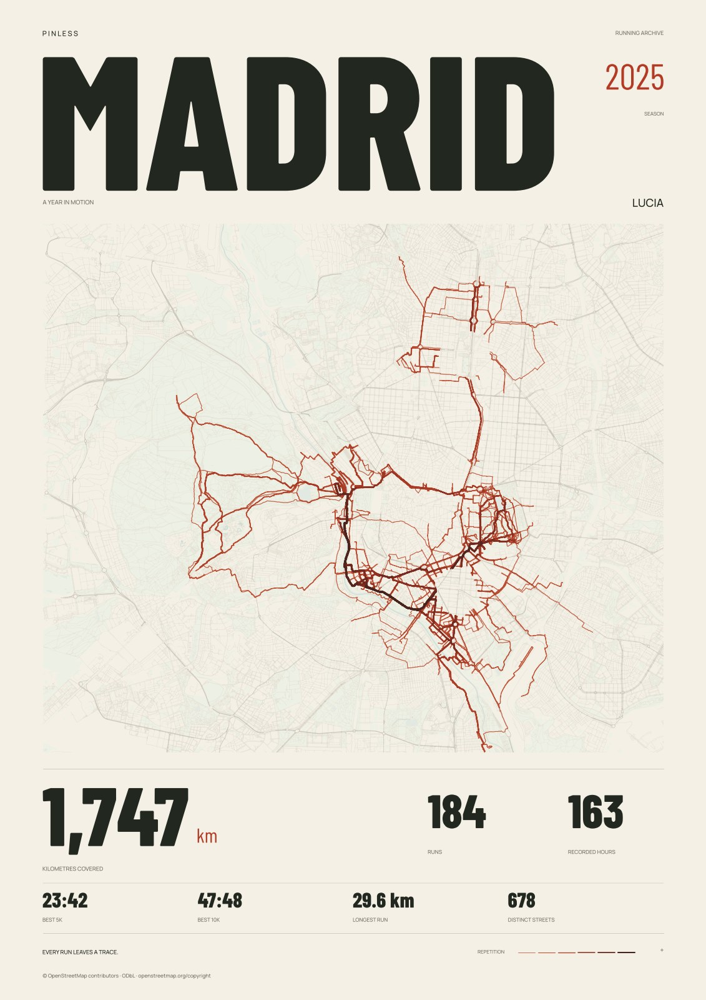
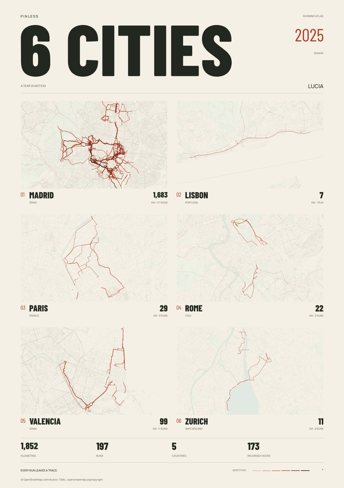

# Pinless

**Your year of running as a print-ready poster of your city. From your Strava export, on your own computer, without showing where you live.**

<p align="center">
  
  
</p>
<p align="center"><sub>Demo posters made from a synthetic runner (<code>tools/simulate_runner.py</code>), not from a real person.</sub></p>

```bash
pip install git+https://github.com/Lostmanu/pinless
pinless export_12345678.zip --name "Lucia" --year 2025 --pdf poster.pdf
```

That is the whole thing. Pinless finds the area where you run most, downloads that area's streets from OpenStreetMap once (cached), removes the places that would give away where you live, and writes `poster.png` and a vector `poster.pdf` ready for a print shop.

## Get your Strava export

On strava.com: **Settings > My Account > Download or Delete Your Account > Request your archive**. Strava emails you a link to a zip, which can take a while. Pass the zip as it is; there is no need to unzip it.

It also works with a folder of GPX, TCX or FIT files exported from Garmin, Coros, Suunto, Komoot or any app that exports GPX.

## What you get

- Every run drawn on your city's OpenStreetMap streets. The routes you repeat get darker and thicker, and a small legend explains it.
- The numbers: distance, runs, recorded hours, best 5K, best 10K, longest run and how many different streets you ran.
- Your name as the inscription, or as the headline (`--headline name`) when it is a gift.
- PNG at 300 dpi, vector PDF and SVG, at A4, A3 or 50x70 cm. A light JPEG preview with `--preview`.
- Two editorial styles: `huella` (warm paper, clay red) and `carbon` (dark green, copper), plus the earlier `classic` and `sport` layouts.
- An atlas of every city you ran in, with `--layout atlas` (below).

## Atlas: every city you ran in

<p align="center">
  
</p>
<p align="center"><sub>Demo atlas from the synthetic runner with trips (<code>tools/simulate_trips.py</code>); try it with <code>pinless demo/strava_export_atlas_demo.zip --layout atlas</code>.</sub></p>

```bash
pinless export_12345678.zip --layout atlas --name "Lucia" --year 2025 --pdf atlas.pdf
```

One small map per city on the same print: the city where you ran most comes first, then the others in the order you first ran there, each with its name, country, kilometres and runs. Line colour means the same in every map, so a street you ran fifty times at home is darker than a one-off loop by the hotel. Up to 9 maps by default (`--max-cities`, at most 12); the smallest cities are left out of the maps, the print says how many, and the totals still count them.

## Privacy

A heatmap of your runs shows where you live. Pinless removes that before drawing anything:

1. It trims the first and last 300 m of every activity.
2. It finds every place where your runs often start or end (home, work, the gym) and deletes all points inside an irregular zone around each one, including runs that only pass by. In the atlas this is done city by city, the private places of every city also protect the others (a long run grouped elsewhere can still start at home), and where you ran only a few times a single loop run is enough to hide where it started (a hotel, a family home).
3. It checks the result. If any line still touches a zone, nothing is exported.
4. It never prints coordinates, start points, activity names or dates, and nothing outside the visible map is written into the PNG, PDF or SVG. The favourite street is never one within 1 km of a private zone.
5. Your files never leave your computer. Only the bounding box of the area is sent out: to OpenStreetMap's Nominatim for the city name and to its Overpass service for the streets (in the atlas, each city's box, and its centre rounded to about 1 km for the name). When the main Overpass server is busy, Pinless tries the public mirror overpass.private.coffee; to use another server, set `PINLESS_OVERPASS` to its API address.

A run that starts in one place and ends in another, once, only has its ends trimmed. This reduces the risk; it is not a guarantee of anonymity. A map of where you run still says something about you. Look at the poster before you share it, and hide more places with `--zone LAT,LON,RADIUS_M` (repeatable).

## Options

| Option | What it does |
|---|---|
| `--year 2025` | Only that year |
| `--type Run` | Activity type from the export (`Run`, `Ride`, `Walk`, `Hike`...) |
| `--place "Valencia, Spain"` | Use a named place instead of the area where you run most |
| `--bbox S,W,N,E` | Use an exact box |
| `--title`, `--name`, `--headline city\|name` | Headline text and inscription |
| `--layout editorial\|atlas`, `--max-cities 9` | One city, or one small map per city |
| `--style huella\|carbon`, `--size A4\|A3\|50x70` | Look and paper |
| `--lang en\|es` | Labels in English or Spanish |
| `--out`, `--pdf`, `--svg`, `--preview` | Outputs |
| `--zone LAT,LON,R` | Extra private zone |

## Use it from a coding agent

`skills/pinless/SKILL.md` lets Claude Code, Codex, Cursor or any agent that reads Agent Skills make the poster for you. The skill only runs the command above. It tells the agent not to open your export, so your GPS points stay out of the conversation.

## How it compares

- [running_page](https://github.com/yihong0618/running_page) builds a personal running website synced from Strava or Garmin. Pinless makes one printable poster.
- [GitHubPoster](https://github.com/yihong0618/GitHubPoster) draws calendar and circular posters of activity. Pinless draws your routes on your city's streets.
- [Heatmapster](https://heatmapster.com) is a free web service that connects to your Strava account. Pinless needs no account connection and runs locally.

## Development

```bash
git clone https://github.com/Lostmanu/pinless && cd pinless
pip install -e ".[dev]"
pytest
```

The demo export in `demo/` is a synthetic runner generated on real OpenStreetMap streets of Madrid by `tools/simulate_runner.py`. Its true home and work points are stored apart in `demo/truth.json`, only so the tests can check that no published line comes near them.

The tests run offline. The street statistics use `tests/data/madrid_streets.json.gz`, a small extract of the named OpenStreetMap streets around the demo runs (ODbL). `tools/make_street_fixture.py` rebuilds it from the full Madrid graph, and its `--check` option confirms that it gives the same street counts as the full graph.

## Credits and license

Map data © OpenStreetMap contributors, available under the ODbL; every poster carries the attribution. Fonts: Barlow Condensed and Manrope, SIL Open Font License 1.1 (`pinless/fonts`). Code: MIT.

Not affiliated with Strava.
