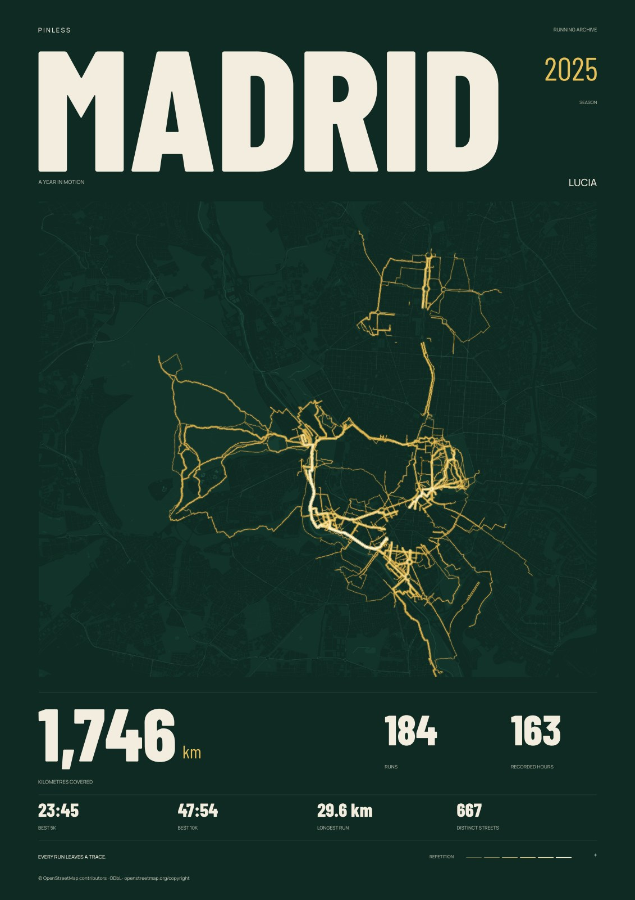
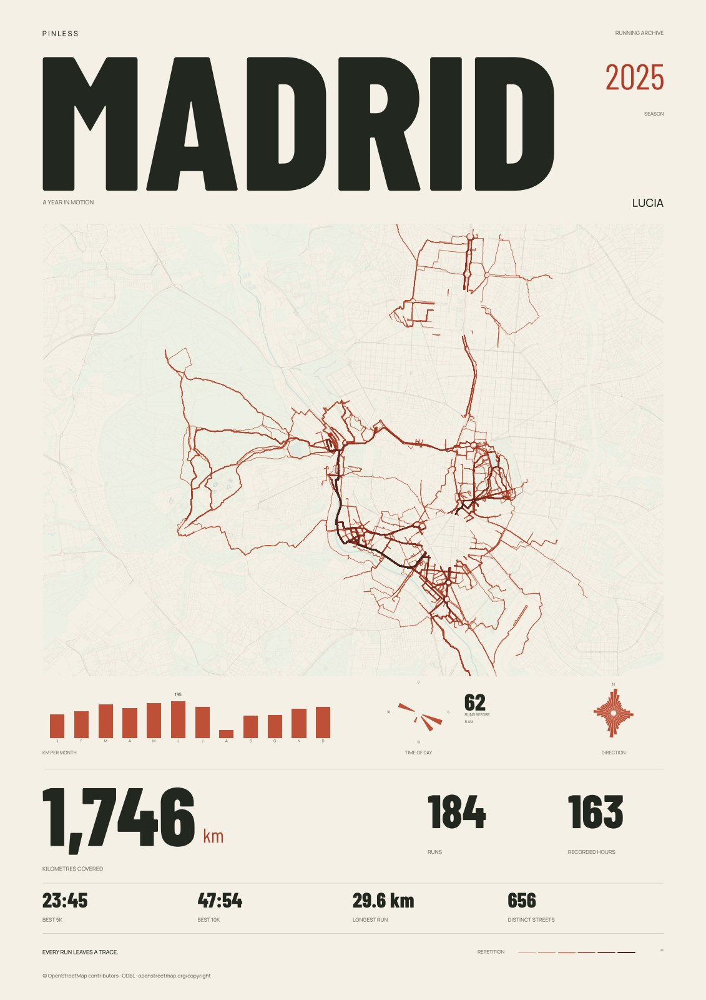
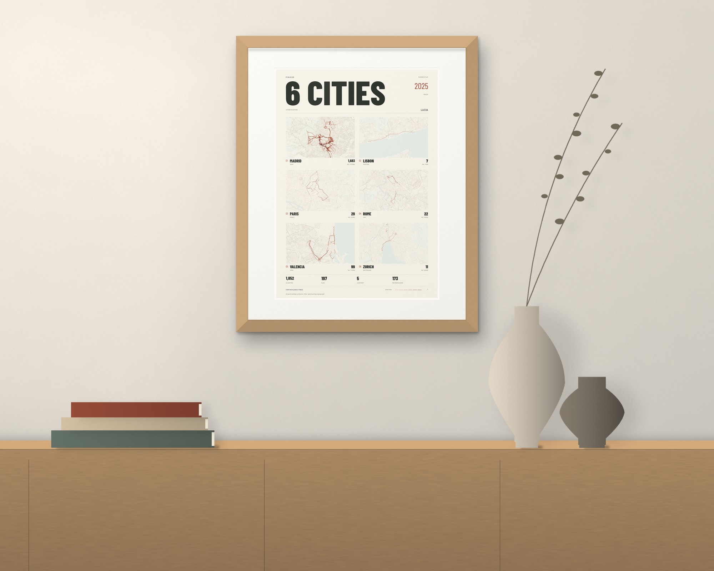
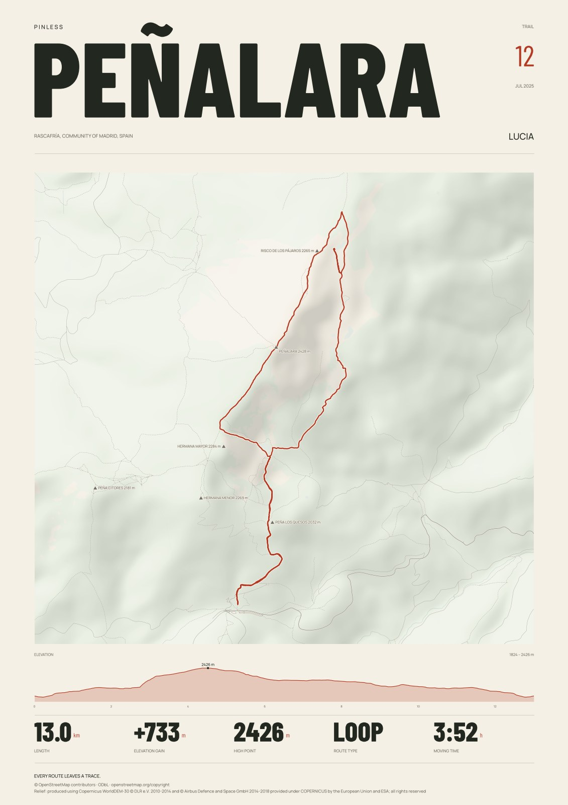
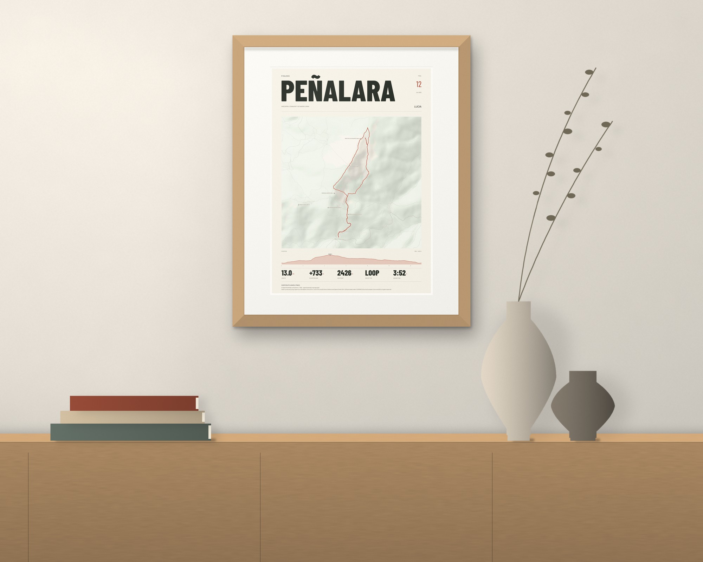
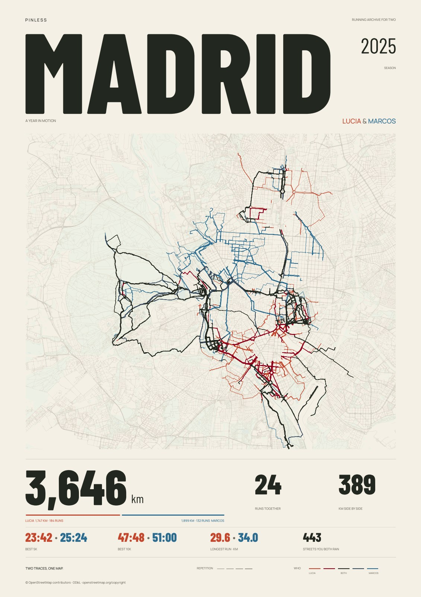

# Pinless

**Your year of running as a print-ready poster of your city. From your Strava export, on your own computer, without showing where you live.**

<p align="center">
  
  
</p>
<p align="center"><sub>A3 prints in standard 40x50 cm frames, drawn to scale (<code>tools/mockup.py</code>). Demo posters made from a synthetic runner (<code>tools/simulate_runner.py</code>), not from a real person.</sub></p>

```bash
pip install https://github.com/Lostmanu/pinless/archive/refs/heads/main.zip
pinless export_12345678.zip --name "Lucia" --year 2025 --pdf poster.pdf
```

That is the whole thing. Pinless finds the area where you run most, downloads that area's streets from OpenStreetMap once (cached), removes the places that would give away where you live, and writes `poster.png` and a vector `poster.pdf` ready for a print shop. It is free, it needs no account, and everything happens on your computer. New to the command line? See [Install, step by step](#install-step-by-step).

## Get your Strava export

On strava.com: **Settings > My Account > Download or Delete Your Account > Request your archive**. Strava emails you a link to a zip, which can take a while. Pass the zip as it is; there is no need to unzip it.

It also works with a folder of GPX, TCX or FIT files exported from Garmin, Coros, Suunto, Komoot or any app that exports GPX, or with a single such file: one hike downloaded from a trail app, a route planner or a watch is an export of one activity, and a file that holds several tracks (an app's export of all your walks) is read as one activity per track, so the places where they start and end are learned as in a folder of files.

## Install, step by step

You need Python (free) and two commands. Nothing to sign up for.

**Windows**

1. Download Python 3.12 or 3.13 from [python.org/downloads](https://www.python.org/downloads/) and run the installer. On its first screen, tick **Add python.exe to PATH**, then click **Install Now**.
2. Open **Terminal** (or **PowerShell**) from the Start menu and install Pinless:
   ```
   py -m pip install https://github.com/Lostmanu/pinless/archive/refs/heads/main.zip
   ```
   It downloads Pinless and the map libraries it uses, a few hundred MB, once.
3. Put your Strava zip in your Downloads folder and make the poster:
   ```
   cd Downloads
   py -m pinless export_12345678.zip --name "Lucia" --year 2025 --preview poster.jpg
   ```
   Use the real name of your zip. Open `poster.jpg` to look at it; `poster.png` (300 dpi) is the file for printing.

**macOS**

1. Download Python 3.12 or 3.13 from [python.org/downloads](https://www.python.org/downloads/), run the installer, then open **Terminal** (Applications > Utilities).
2. Install Pinless:
   ```
   python3 -m pip install https://github.com/Lostmanu/pinless/archive/refs/heads/main.zip
   ```
3. Make the poster:
   ```
   cd ~/Downloads
   python3 -m pinless export_12345678.zip --name "Lucia" --year 2025 --preview poster.jpg
   ```

**Linux**, or if pip answers "externally-managed-environment" (Homebrew Python): install it in its own folder.

```
python3 -m venv ~/pinless
~/pinless/bin/pip install https://github.com/Lostmanu/pinless/archive/refs/heads/main.zip
~/pinless/bin/pinless export_12345678.zip --name "Lucia" --year 2025 --preview poster.jpg
```

Good to know:

- The first poster of a city takes a few minutes: Pinless downloads that area's streets once and keeps them for the next time.
- If it says `[osm] STOP`, the public map servers are busy. Run the same command again later.
- Add `--pdf poster.pdf` for a print shop, `--size A4`, `A3` or `50x70`, `--lang es` for Spanish labels, and any of the styles below with `--style`. `py -m pinless --help` (Windows) or `python3 -m pinless --help` lists every option.
- To update Pinless, run the install command again with `--upgrade` after `install`.

## What you get

<p align="center">
  
  
</p>

- Every run drawn on your city's OpenStreetMap streets, parks, rivers and sea (the sea and estuaries come from the coastline). The routes you repeat get darker and thicker, and a small legend explains it.
- The numbers: distance, runs, recorded hours, best 5K, best 10K, longest run and how many different streets you ran.
- Your name as the inscription, or as the headline (`--headline name`) when it is a gift.
- PNG at 300 dpi, vector PDF and SVG, at A4, A3 or 50x70 cm. A light JPEG preview with `--preview`.
- Twelve styles (below), plus the earlier `classic` and `sport` layouts.
- Routes coloured by how often you ran them, or by month, pace or elevation (`--color-by`).
- An optional band of charts: kilometres per month, the time of day you run and the direction of your streets (`--graphs`).
- An atlas of every city you ran in (`--layout atlas`), a finisher print of one race (`--layout race`) and a trail print of one hike or mountain route (`--layout trail`), all below.
- Shaded terrain relief where your area has hills (`--relief shade`, on by default for the trail print), from the Copernicus elevation model. It sits under the routes, quieter than the faintest of them, and stays off the water; flat cities get none.
- One poster for two people, one ink each (`--with`), below.

## Styles

<p align="center"></p>

`--style` picks one of `huella`, `carbon`, `midnight`, `blueprint`, `ink`, `graphite`, `neon`, `lavender`, `sunset`, `forest`, `blush` and `ocean`. They work for the poster, the atlas and the race print. The dark ones (`midnight`, `graphite`, `neon`) give the routes a soft glow, still drawn as vectors.

## Your own style

<p align="center"></p>

Any style is a small text file you can write yourself. This one (`styles/emerald.json` in this repository) starts from `carbon` and changes the paper, the map and the routes:

```json
{
  "base": "carbon",
  "bg": "#0e2a22",
  "green": "#123329",
  "water": "#163b30",
  "water_line": "#1f4a3d",
  "rule": "#3e5d52",
  "street": {"major": ["#2a5144", 0.50], "minor": ["#22473a", 0.32], "path": ["#1f4135", 0.24]},
  "accent": "#e8c15a",
  "heat": ["#8f7a3c", "#b89645", "#e0b84f", "#f3d98c", "#fff4cf"],
  "glow": 0.12
}
```

```bash
pinless export_12345678.zip --name "Lucia" --style emerald.json
```

- `base` (optional): one of the twelve styles; anything you do not list is taken from it.
- `bg` paper, `ink` titles and numbers, `sub` small text, `accent` the year and the "km" unit.
- `green` parks, `water` rivers, lakes and sea, `water_line` thin waterways, `rule` the lines between sections.
- `street`: colour and line width in points of main roads, side streets and paths.
- `heat`: five route colours, from a street run once to the one you ran most.
- `glow` (optional, 0 to 0.5): a soft halo under the routes, for dark paper.
- `who` (optional): five inks for the poster for two (first person, mostly first, both, mostly second, second).

Colours are `#rrggbb` or a name such as `white`. To start from every value of a style, write it to a file with `python -m pinless.styles midnight > my-style.json` (on Windows, `py -m pinless.styles midnight > my-style.json`), then edit it. A file with a mistake is refused with a message that says what to change, and Pinless warns you when a colour would be hard to read on your paper. Style files work for the poster, the atlas, the race print and the poster for two.

## Colour and charts

<p align="center"></p>

The line weight always grows with how often you ran a street; `--color-by` decides what the colour says: `heat` (how often, the default), `single` (one ink), `month` (when in the year), `pace` (how fast each run was) or `elevation` (how high, from your watch). `--graphs` adds kilometres per month, a 24-hour rose of when you start and a rose of the directions you run, all in the local time and place of each run.

<p align="center"></p>

## Atlas: every city you ran in

<p align="center">
  
  
</p>
<p align="center"><sub>Demo atlas from the synthetic runner with trips (<code>tools/simulate_trips.py</code>); try it with <code>pinless demo/strava_export_atlas_demo.zip --layout atlas</code>.</sub></p>

```bash
pinless export_12345678.zip --layout atlas --name "Lucia" --year 2025 --pdf atlas.pdf
```

One small map per city on the same print: the city where you ran most comes first, then the others in the order you first ran there, each with its name, country, kilometres and runs. Line colour means the same in every map, so a street you ran fifty times at home is darker than a one-off loop by the hotel. Up to 9 maps by default (`--max-cities`, at most 12); the smallest cities are left out of the maps, the print says how many, and the totals still count them.

## Race: one run as a finisher print

<p align="center">
  
  
</p>

```bash
pinless export_12345678.zip --layout race --activity 2025-04-06 --title "Spring Half Marathon" --name "Lucia"
```

The course coloured by your pace along it (or `--color-by elevation` or `single`), its elevation profile, distance, time, pace, climb and every kilometre split, with its date. The headline is the city unless you give one with `--title`: the activity's own name is not printed by default, because names often say where a run starts ("from Mum's"). `--activity` takes `longest` (the default), `latest`, a date or an activity id.

A run that starts or ends at one of your private places (a long run from home) is refused, since one course drawn from your door points at it. Pick another run, or pass `--allow-private-ends`: the print then shows one unbroken stretch of the run that stays more than 1.6 to 2.6 zone radii (800 to 1300 m by default, drawn at random each time) from those places, wherever the run comes back to them, shortened by a random 200 to 800 m at each end that one lies beyond, and its distance, time, pace, profile, climb and splits describe only that stretch.

## Trail: one route as a print

<p align="center">
  
  
</p>
<p align="center"><sub>Demo route: a synthetic hike on real OpenStreetMap paths, with heights from the Copernicus elevation model (<code>tools/simulate_hike.py</code>), not a real person's walk. Try it with <code>pinless demo/hike_demo.gpx --layout trail --title "Peñalara"</code>.</sub></p>

```bash
pinless my-hike.gpx --layout trail --title "Peñalara" --name "Lucia"
pinless export_12345678.zip --layout trail --activity 2025-07-12 --title "Peñalara"
```

One hike, trail run or mountain loop on a topographic map: terrain relief (on by default for this print, `--relief off` turns it off), paths and tracks drawn stronger than on a city poster, roads over the relief in an ink at least as strong, woods and water, and up to six named summits with their heights. Under the map, the elevation profile with its highest point marked, and the route's length, elevation gain, high point, route type (loop, out and back or point to point) and time; when the clock shows pauses longer than two minutes, the moving time. The route is drawn in the style's accent colour, or coloured by `--color-by elevation` or `pace`.

The export can be a Strava export or a single GPX, TCX or FIT file, as a trail app, a route planner or a watch downloads it. Every activity type counts for this print (`--type Hike` narrows the choice), and `--activity` picks one as for the race print. The headline is the place unless you give one with `--title`: the activity's own name is not printed by default, because names often say where a walk starts.

The privacy rules are the race print's. A route that starts or ends at one of your private places, learned from every other activity in the export whatever its type, is refused; with `--allow-private-ends`, only one unbroken stretch well clear of those places is drawn, and every number describes that stretch. A single file holds no other activities to learn your places from, so only `--zone` protects its ends: if it starts at your door, add `--zone` there. The log says so, and says when a loop is drawn as if it started at a public trailhead.

## For two: one map, one ink each

<p align="center">
  
  
</p>
<p align="center"><sub>Demo poster from two synthetic runners (<code>tools/simulate_runner.py</code>); try it with <code>pinless demo/strava_export_madrid_demo.zip --with demo/strava_export_madrid_partner_demo.zip --name Lucia --with-name Marcos</code>.</sub></p>

```bash
pinless lucia.zip --with marcos.zip --name "Lucia" --with-name "Marcos" --year 2025 --pdf pareja.pdf --preview pareja.jpg
pinless lucia.zip --with marcos.zip --name "Lucía" --with-name "Marcos" --headline name --style midnight --lang es
```

Two exports, one editorial poster. The map is the area where you both run: a place only one of you runs never wins it (`--place` or `--bbox` choose another). Each export is read with its own type (`--with-type` when the second one names the sport differently), and if only some of one person's activities fall inside the map, Pinless says how many, with that person's name.

What the colours mean. The colour of a street says whose it is, in five steps: the first person's ink, mostly the first person's, both (the style's own ink), mostly the second person's, the second person's ink. It is the street's share, measured on paper: two lines less than about half a millimetre apart on an A3 print are one street (the same distance on the ground at every paper size), and the colour belongs to the street, not to the line, so one run of yours on a street the other ran twenty times takes their ink. If one of you only ran streets the other ran far more often, that person's own ink hardly appears on the map (the names, the bar and the key still show it), and Pinless says so when it makes the poster. The line weight is how often either of you ran the street, counted the same way: a street one of you ran six times is as heavy as one you each ran three times. The first export always takes the warm ink; swap the exports to swap the inks. `--color-by` and `--graphs` do not apply to a poster for two.

The numbers, and how each is computed. Every number comes from the coordinates and the clocks in the two files (and the street count from the map's OpenStreetMap street names); nothing else is looked up.

- Kilometres: both of you together, and a bar that splits them between you. A run together counts for each of you, since each of you ran it.
- Runs together and kilometres side by side: two activities, one of each of you, that overlap in time for at least 10 minutes (and half of the shorter one) and stay close (a median gap of 75 m or less, and within 150 m for 80 % of the shared time), each activity matched once. The kilometres are the mean of what the two of you covered while together. Without a clock in one of the exports, or with no run together, these two cells show your runs and recorded hours instead.
- Best 5K, best 10K and longest run: one for each of you, side by side, in your own ink.
- Streets you both ran: counted on the drawn lines only, after the privacy cuts.

Privacy for two. A map of two people's runs can show both homes, and the visits between them, so:

- Every private place of either of you (a home, a workplace, a gym) hides both people's lines. Each person's places are found with that person's own threshold, so the one who runs less keeps their places too, and with fewer than 75 runs a single loop already marks where it started.
- One zone per place: a home you share, or a door both of you run from, is one zone, drawn once and cutting both lines, so both inks break at the same edge and no hole in one ink is crossed by the other.
- Places where your ends meet are hidden even when neither of you alone starts or ends there often enough to make it a place (a cafe where you meet).
- If one of you has nothing left on the map after the cuts, nothing is exported, rather than a poster of only one of you. A `--zone` hides both people's lines.
- The colour around a hole says whose neighbourhood it is. That is the same thing `--name` already ties to a person on a solo poster.
- Not covered: several posters of the same place (one of each of you and one together, each with its own random zones) laid over each other narrow a hole down; a solo poster of one of you made without `--with` still shows the runs from the other's door; and, as on a solo poster, a place you started from only a few times among many runs, or only in another year or with another activity type, is not learned. Hide such places with `--zone`.

Use the other person's export only with their consent; make the poster together and look at it before printing or sharing it.

## Privacy

A heatmap of your runs shows where you live. Pinless removes that before drawing anything:

1. It trims the first and last 300 m of every activity.
2. It finds every place where your runs often start or end (home, work, the gym) and deletes all points inside an irregular zone around each one, including runs that only pass by. In the atlas this is done city by city, the private places of every city also protect the others (a long run grouped elsewhere can still start at home), and where you ran only a few times a single loop run is enough to hide where it started (a hotel, a family home).
3. It checks the result. If any line still touches a zone, nothing is exported.
   The race print works on a single course and always draws one unbroken stretch of it. A course that only passes one of your private places is drawn whole, since a gap in it would point at the very place it hides. A run that starts or ends at a private place (within 1.5 zone radii, in its first or last 300 m) is refused unless you pass `--allow-private-ends`, which keeps a stretch well clear of that place, as above; a `--zone` is always kept clear the same way. For the race print, a private place is also where two or more of your other runs start or end close to where this one does, within 1.5 zone radii of its first or last 300 m (a new home, a holiday flat, before years of history learn it). A loop from a place none of your other runs starts from (a first run from a hotel) cannot be told from a race start: it is drawn whole, and Pinless says so, so you can add a `--zone` there. The trail print follows the same rules, with the places learned from every other activity of the export whatever its type.
4. It never prints coordinates or start points, and nothing outside the visible map is written into the PNG, PDF or SVG. The edges of an area Pinless finds from your runs, and the crop of `--fit`, are rounded outward to a grid of about 1 km, so the map's frame does not mark where a run at the edge of the area started (a partner's lodging, a hotel). Dates are printed only on the race and trail prints, where they are the point, and never an activity's own name: their headline is the place or what you write with `--title`. The favourite street is never one within 1 km of a private zone.
5. Your files never leave your computer. Only the area is sent out: its bounding box (on that 1 km grid, when Pinless finds the area) to OpenStreetMap's Overpass service for the streets, and its centre, rounded to about 1 km, to OpenStreetMap's Nominatim for the city name (in the atlas, the same for each city). A second export (`--with`) adds no request. When the main Overpass server is busy, Pinless tries the public mirror overpass.private.coffee; to use another server, set `PINLESS_OVERPASS` to its API address. With `--relief shade` (on by default for the trail print), Pinless also downloads elevation data from the Copernicus DEM on Amazon S3, which learns which 1-degree cell, and which block of about 30 km inside it, your map covers; never your routes. Without it nothing is sent there. Downloaded elevation is cached next to the map data. Like the map data, that cache shows on your computer which areas you made posters of; delete the cache folder (`~/.cache/pinless`, or the folder in `PINLESS_CACHE`) to remove it.

A single GPX, TCX or FIT file of one activity holds no other activities to learn your places from, whatever the layout: only `--zone` protects its ends (every print still trims its first and last 300 m), and Pinless says so. If it starts at your door, add `--zone` there. A file that holds many tracks is read as one activity per track, so their places are learned as usual.

Stray GPS fixes at the start or end of a file (a watch that opens with yesterday's position, then jumps) are dropped on import. A run that starts in one place and ends in another, once, only has its ends trimmed. This reduces the risk; it is not a guarantee of anonymity. A map of where you run still says something about you. Look at the poster before you share it, and hide more places with `--zone LAT,LON,RADIUS_M` (repeatable).

## Options

| Option | What it does |
|---|---|
| `--year 2025` | Only that year |
| `--type Run` | Activity type from the export (`Run`, `Ride`, `Walk`, `Hike`...); `Run` by default, any type for the trail print or a single file |
| `--place "Valencia, Spain"` | Use a named place instead of the area where you run most |
| `--bbox S,W,N,E` | Use an exact box |
| `--title`, `--name`, `--headline city\|name` | Headline text and inscription |
| `--layout editorial\|atlas\|race\|trail`, `--max-cities 9`, `--activity longest`, `--allow-private-ends` | One city, one small map per city, one race, or one route on a topographic map |
| A single GPX, TCX or FIT file as the export | One hike from a trail app or a watch, on any layout: only `--zone` protects its ends, since a single file has no other activities to learn your places from |
| `--color-by heat\|single\|month\|pace\|elevation`, `--graphs` | What the line colour says; the band of charts |
| `--style huella\|carbon\|midnight\|...\|my-style.json`, `--size A4\|A3\|50x70` | One of twelve styles, or your own style file; paper |
| `--relief off\|shade` | Terrain relief under the map where the land is hilly (off by default, on for the trail print) |
| `--lang en\|es` | Labels in English or Spanish |
| `--out`, `--pdf`, `--svg`, `--preview` | Outputs |
| `--zone LAT,LON,R` | Extra private zone, latitude first, radius in metres (with `--with`, it hides both people's lines). On a single map, a zone that does not touch the map stops the export: it would hide nothing |
| `--with EXPORT`, `--with-name NAME` | A second person's export and name: one poster for two, one ink each |
| `--with-type Run` | Activity type in the second export, when it names the sport differently (default: `--type`) |

## Use it from a coding agent

`skills/pinless/SKILL.md` lets any coding agent that reads Agent Skills make the poster for you. The skill only runs the command above. It tells the agent not to open your export, so your GPS points stay out of the conversation.

## How it compares

- [running_page](https://github.com/yihong0618/running_page) builds a personal running website synced from Strava or Garmin. Pinless makes one printable poster.
- [GitHubPoster](https://github.com/yihong0618/GitHubPoster) draws calendar and circular posters of activity. Pinless draws your routes on your city's streets.
- [Heatmapster](https://heatmapster.com) is a free web service that connects to your Strava account. Pinless needs no account connection and runs locally.

## Development

```bash
git clone https://github.com/Lostmanu/pinless && cd pinless
pip install -e ".[dev]"
pytest
```

The demo export in `demo/` is a synthetic runner generated on real OpenStreetMap streets of Madrid by `tools/simulate_runner.py`. Its true home and work points are stored apart in `demo/truth.json`, only so the tests can check that no published line comes near them. The partner demo (`demo/strava_export_madrid_partner_demo.zip`) is a second synthetic runner with their own home and workplace, who runs some weekend runs side by side with the first one, from the first one's door; its places and the number of runs together are in `demo/truth_partner.json`. The demo hike (`demo/hike_demo.gpx`) is a synthetic loop over Peñalara built by `tools/simulate_hike.py` on OpenStreetMap paths, with heights sampled from the Copernicus elevation model; the print itself never samples heights, it only shades the relief.

The tests run offline. The street statistics use `tests/data/madrid_streets.json.gz`, a small extract of the named OpenStreetMap streets around the demo runs (ODbL). `tools/make_street_fixture.py` rebuilds it from the full Madrid graph, and its `--check` option confirms that it gives the same street counts as the full graph.

## Credits and license

Map data © OpenStreetMap contributors, available under the ODbL; every poster carries the attribution. Fonts: Barlow Condensed and Manrope, SIL Open Font License 1.1 (`pinless/fonts`). Code: MIT.

Terrain relief (`--relief shade`) comes from the Copernicus DEM, GLO-30, or GLO-90 for a print where GLO-30 lacks a land cell, under the [Copernicus DEM licence](https://dataspace.copernicus.eu/sites/default/files/media/files/2025-06/copernicus_contributing_mission_data_access_v2_cop_dem_licenses.pdf) (also [License-COPDEM-30](https://documentation.dataspace.copernicus.eu/APIs/SentinelHub/Data/DEM/resources/license/License-COPDEM-30.pdf)). A poster with relief carries the notice of the dataset it used:

- "produced using Copernicus WorldDEM-30 © DLR e.V. 2010-2014 and © Airbus Defence and Space GmbH 2014-2018 provided under COPERNICUS by the European Union and ESA; all rights reserved"
- "produced using Copernicus WorldDEM™-90 © DLR e.V. 2010-2014 and © Airbus Defence and Space GmbH 2014-2018 provided under COPERNICUS by the European Union and ESA; all rights reserved"

The organisations in charge of the Copernicus programme by law or by delegation do not incur any liability for any use of the Copernicus WorldDEM-30. The organisations in charge of the Copernicus programme by law or by delegation do not incur any liability for any use of the Copernicus WorldDEM™-90.

Pinless is not endorsed by the Copernicus programme. The relief is a smoothed hillshade of a surface model (modified data), not for navigation. If you share or sell a poster with relief, keep its relief notice. `tools/check_relief.py` checks the elevation reader against Pillow on real data and draws the sheets to look at before a change to the relief is merged.

Not affiliated with Strava.
